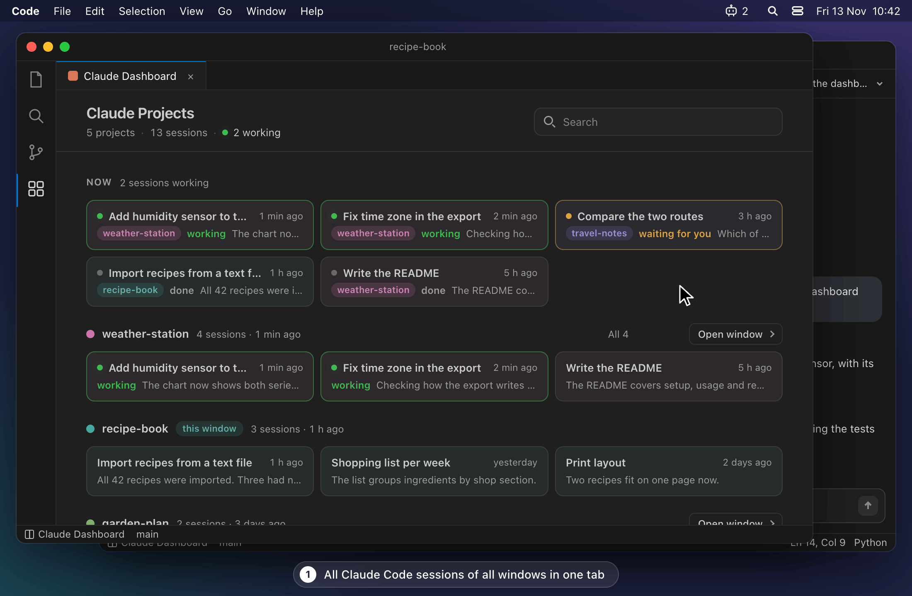
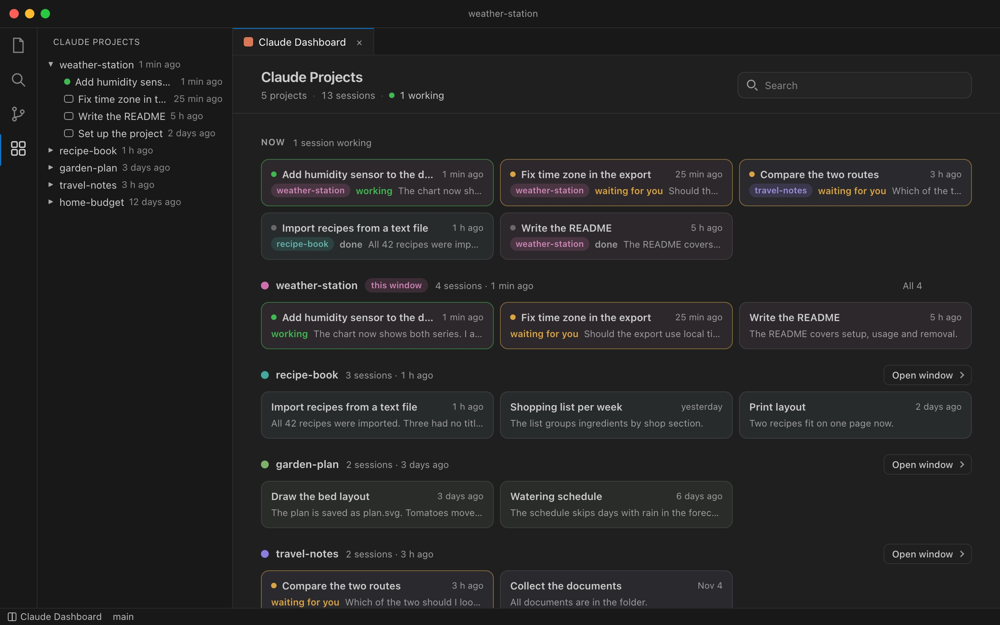
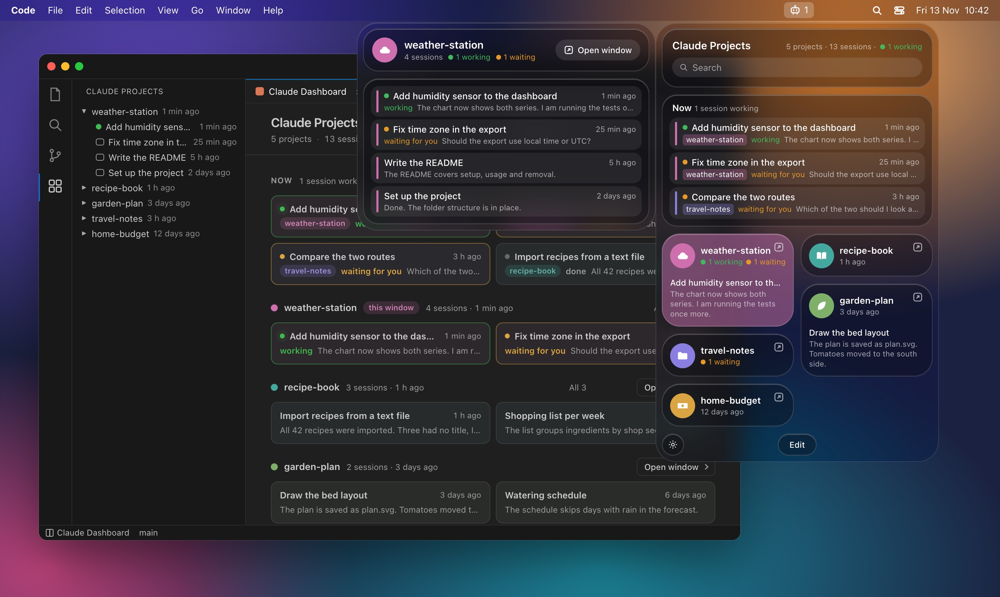
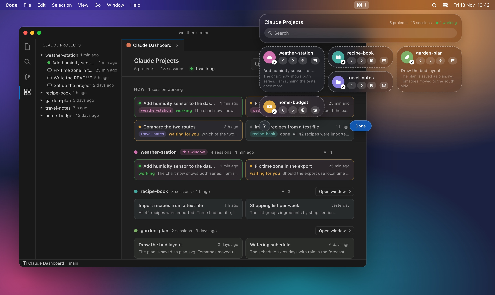

# Claude Dashboard

Running **Claude Code** in several VS Code windows at once? Claude Dashboard
shows every session from every project in one place – which ones are working,
which are waiting for you – and one click brings the right window to the front
with that session open. No more hunting through a dozen windows.

Made for people who use the Claude Code extension in VS Code with one window
per project. Optional menu bar app for macOS.

> Unofficial community project – not affiliated with or endorsed by Anthropic.



*The pictures on this page are illustrations with made-up projects, rebuilt in
HTML (see `docs/demo`). The dashboard in them is the extension's real code.*

## Features

- **Dashboard tab:** compact cards for every session, grouped by project, with
  title, last activity and Claude's latest message.
- **"Now" at the top:** sessions that are working or waiting for you, plus the
  ones you used recently – across all projects.
- **Status:** working · waiting for you · done (estimated from the session files).
- **Organize:** give each project one of 24 colors (click its color dot), archive
  projects you don't need right now and restore them later.
- **Sidebar view "Claude Projects"** listing all projects and sessions.
- Follows your VS Code theme, light and dark. English and German UI (follows
  the VS Code display language).



## Requirements

- VS Code 1.94 or newer
- The **Claude Code** extension by Anthropic, signed in and in use. The
  dashboard reads its sessions.

## Install

1. In VS Code open **Extensions** (`Cmd/Ctrl+Shift+X`), search for
   **Claude Dashboard** and click **Install** – or open its
   [Marketplace page](https://marketplace.visualstudio.com/items?itemName=michael-schroeter.claude-dashboard).
2. Reload the other open VS Code windows once
   (`Cmd/Ctrl+Shift+P` → "Developer: Reload Window"), so that every window can
   open its own sessions.
3. Click **"Claude Dashboard"** in the status bar (bottom left).

Updates arrive automatically.

**Coming from a `.vsix` (version 0.4 or older)?** Install it from the
Marketplace as above. The new version notices the older copy and offers to
remove it; your colors, titles and archive are taken over.

Without the Marketplace: download `claude-dashboard-<version>.vsix` from the
[Releases](https://github.com/michael-schroeter/claude-dashboard/releases) page
and choose **Extensions** → **"…"** → **"Install from VSIX…"**.

## Menu bar app (macOS, optional)

A small companion app puts the same overview into the macOS menu bar, in the
style of Control Center. The number next to the icon is the count of working
sessions.



- **Now:** sessions that are working or waiting for you, across all projects.
- **Project tiles** show how many sessions are working or waiting. Click a
  tile to open a second panel with that project's sessions. Click the arrow
  on a tile to bring the project's VS Code window to the front.
- Click a **session** to open it in its project window. This needs the VS Code
  extension to be installed, because the extension in that window opens the
  session. Without it, only the window opens.
- **Edit** (button at the bottom) lets you arrange the tiles by dragging or
  with the arrows, give each project its own title, a symbol and a color, switch a tile between small and
  large (a large tile also shows the latest session and Claude's last
  message), and archive or restore projects.
- The gear menu sets the number of **columns** (2 to 5), which is also the
  width of the panel, and **Start at login** (off by default).
- Colors, titles and the archive are shared with the VS Code dashboard. Order,
  symbols, tile sizes and columns belong to the app.
- Tiles keep their place. In edit mode, drag a tile onto any place, empty or
  not: gaps stay, and a tile that is in the way swaps places with it. Each
  number of columns keeps its own layout. A new project is added after the
  last tile. "Sort by last use" (gear menu) closes the gaps again.
- The **"+" tile** starts a new project: a folder chooser opens, you choose
  or create a folder, and it opens in VS Code. The project gets its tile once
  a Claude session exists in that folder. The folder in which the chooser
  starts is set in the gear menu.
- Uses clear Liquid Glass on macOS 26 and the standard blur material on older
  versions. The soft blur behind the glass comes from a window server function
  that is not part of the documented API; should a future macOS drop it, the
  panel works the same, just without that blur.



**Light on resources:** while the panel is closed the app draws nothing and
keeps no views in memory. It is woken by file changes instead of polling,
looks at most every 5 seconds, and reads only the lines that were appended to
a session file. Measured on an Apple silicon Mac: no measurable CPU use when
no session is running, about 0.2 % of one core while a session is working,
around 50 MB of memory.

### Install the app

Needs macOS 13 or newer. The app comes with the VS Code extension, so there is
nothing else to download:

1. Install the extension (see above).
2. Open the dashboard. A note offers to install the menu bar app; click
   **Install**. Or run **"Claude Dashboard: Install Menu Bar App (macOS)"**
   from the command palette, or from the "…" menu of the "Claude Projects"
   sidebar view.
3. The app is copied to your Applications folder and starts. Look for the small
   agent in the menu bar.

When a newer extension brings a newer app, it offers to update it once.

To remove it, switch off "Start at login" if you used it, quit the app from
the gear menu and delete it from the Applications folder.

Without VS Code: download `Claude-Dashboard-menubar-<version>.zip` from the
[Releases](https://github.com/michael-schroeter/claude-dashboard/releases) page,
unzip it and move the app to Applications. That copy is not signed with an
Apple developer account, so macOS blocks the first start: open **System
Settings → Privacy & Security** and click **Open Anyway** (needed only once).

### Build the app yourself

With the Swift compiler that comes with Xcode (no other tools):

```sh
sh menubar/build.sh
```

The app ends up in `dist/`. An app you build yourself starts without the
warning above.

The session reader exists twice: `lib/sessions.js` for the extension and
`menubar/Sources/Sessions.swift` for the app. Change both together.

## Privacy

The extension reads Claude Code's session files (`~/.claude/projects`)
**locally only**. It has no network access, sends nothing anywhere and loads no
third-party scripts. Colors and the archive are stored locally in the
extension's own storage folder.
The menu bar app follows the same rules: local files only, no network access.

## Good to know

- Opening a session relies on an **undocumented** command of the Claude Code
  extension. An update of Claude Code may break jumping into the session; the
  project window still opens.
- "waiting for you" is an estimate: Claude is in the middle of a turn but
  hasn't written anything for 3 minutes (usually a question or a permission
  prompt).
- So far only tested on macOS.

## Uninstall

In VS Code: **Extensions** → "Claude Dashboard" → **Uninstall**.

## Build it yourself

No Node or npm required, just Python 3:

```sh
sh menubar/build.sh        # the menu bar app, which goes into the package
python3 tools/package.py
```

The package ends up in `dist/`. Building the app needs the Swift compiler that
comes with Xcode.

The pictures on this page are rendered from the pages in `docs/demo` with
headless Chrome: `sh docs/demo/render.sh` for the still pictures and
`sh docs/demo/render-gif.sh` for the animation (needs Chrome and swiftc).

To publish a new version: build the package as above and upload
`dist/claude-dashboard-<version>.vsix` on the publisher's
[Marketplace management page](https://marketplace.visualstudio.com/manage).

## License

[MIT](LICENSE)
