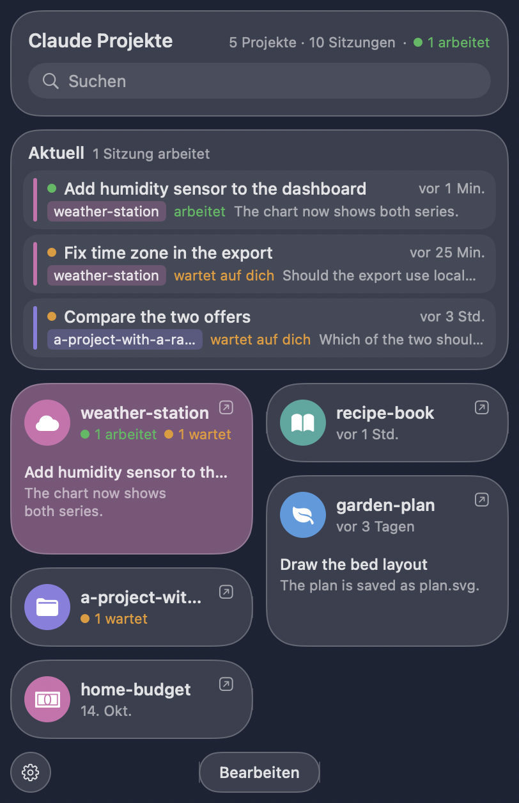
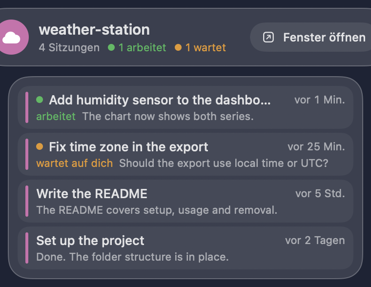
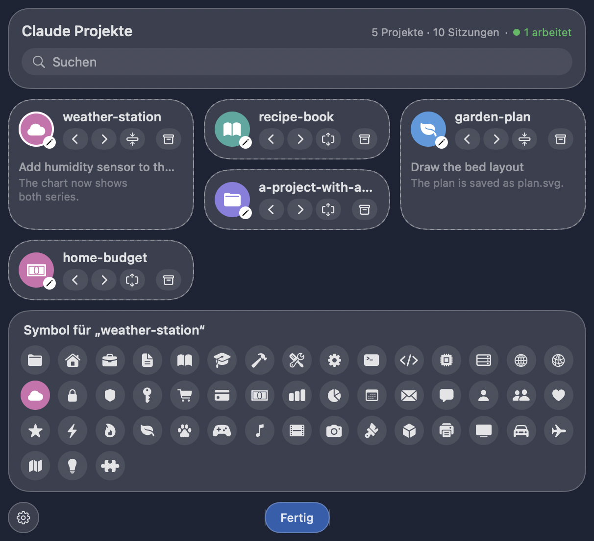

# Claude Dashboard

A VS Code extension that shows all your **Claude Code** sessions from every
project in one place. No more hunting through a dozen VS Code windows: click a
session and the right project window comes to the front with that session open.

> Unofficial community project – not affiliated with or endorsed by Anthropic.

## Features

- **Dashboard tab:** compact cards for every session, grouped by project, with
  title, last activity and Claude's latest message.
- **"Now" at the top:** sessions that are working or waiting for you, plus the
  ones you used recently – across all projects.
- **Status:** working · waiting for you · done (estimated from the session files).
- **Organize:** give each project a color (click its color dot), archive
  projects you don't need right now and restore them later.
- **Sidebar view "Claude Projects"** listing all projects and sessions.
- Follows your VS Code theme, light and dark. English and German UI (follows
  the VS Code display language).

## Requirements

- VS Code 1.94 or newer
- The **Claude Code** extension by Anthropic, signed in and in use. The
  dashboard reads its sessions.

## Install

1. Download `claude-dashboard-<version>.vsix` from the
   [Releases](https://github.com/michael-schroeter/claude-dashboard/releases) page.
2. In VS Code open **Extensions** → **"…"** (top right) →
   **"Install from VSIX…"** and pick the file.
3. Reload every open VS Code window once
   (`Cmd/Ctrl+Shift+P` → "Developer: Reload Window").
4. Click **"Claude Dashboard"** in the status bar (bottom left).

Updates are not automatic: to update, install the newer `.vsix` the same way.

## Menu bar app (macOS, optional)

A small companion app puts the same overview into the macOS menu bar, in the
style of Control Center. The number next to the icon is the count of working
sessions.

<p>
  
  
</p>

- **Now:** sessions that are working or waiting for you, across all projects.
- **Project tiles** show how many sessions are working or waiting. Click a
  tile to open a second panel with that project's sessions. Click the arrow
  on a tile to bring the project's VS Code window to the front.
- Click a **session** to open it in its project window. This needs the VS Code
  extension to be installed, because the extension in that window opens the
  session. Without it, only the window opens.
- **Edit** (button at the bottom) lets you arrange the tiles by dragging or
  with the arrows, give each project a symbol, switch a tile between small and
  large (a large tile also shows the latest session and Claude's last
  message), and archive or restore projects.
- The gear menu sets the number of **columns** (2 to 5), which is also the
  width of the panel, and **Start at login** (off by default).
- Colors and the archive are shared with the VS Code dashboard. Order,
  symbols, tile sizes and columns belong to the app.
- Uses Liquid Glass on macOS 26 and the standard blur material on older
  versions.

<p>
  
</p>

The pictures show made-up projects, drawn without the glass effect.

**Light on resources:** while the panel is closed the app draws nothing and
keeps no views in memory. It is woken by file changes instead of polling,
looks at most every 5 seconds, and reads only the lines that were appended to
a session file. Measured on an Apple silicon Mac: no measurable CPU use when
no session is running, about 0.2 % of one core while a session is working,
around 50 MB of memory.

### Install the app

Needs macOS 13 or newer.

1. Download `Claude-Dashboard-menubar-<version>.zip` from the
   [Releases](https://github.com/michael-schroeter/claude-dashboard/releases)
   page and unzip it.
2. Move `Claude Dashboard.app` to your Applications folder and open it.
3. The app is not signed with an Apple developer account, so macOS blocks the
   first start. Open **System Settings → Privacy & Security**, scroll down and
   click **Open Anyway**. This is needed only once.

To remove it, switch off "Start at login" if you used it, quit the app from
the gear menu and delete it.

### Build the app yourself

With the Swift compiler that comes with Xcode (no other tools):

```sh
sh menubar/build.sh
```

The app ends up in `dist/`. An app you build yourself starts without the
warning above.

The session reader exists twice: `lib/sessions.js` for the extension and
`menubar/Sources/Sessions.swift` for the app. Change both together.

## Privacy

The extension reads Claude Code's session files (`~/.claude/projects`)
**locally only**. It has no network access, sends nothing anywhere and loads no
third-party scripts. Colors and the archive are stored locally in the
extension's own storage folder.
The menu bar app follows the same rules: local files only, no network access.

## Good to know

- Opening a session relies on an **undocumented** command of the Claude Code
  extension. An update of Claude Code may break jumping into the session; the
  project window still opens.
- "waiting for you" is an estimate: Claude is in the middle of a turn but
  hasn't written anything for 3 minutes (usually a question or a permission
  prompt).
- So far only tested on macOS.

## Uninstall

In VS Code: **Extensions** → "Claude Dashboard" → **Uninstall**.

## Build it yourself

No Node or npm required, just Python 3:

```sh
python3 tools/package.py
```

The package ends up in `dist/`.

## License

[MIT](LICENSE)
